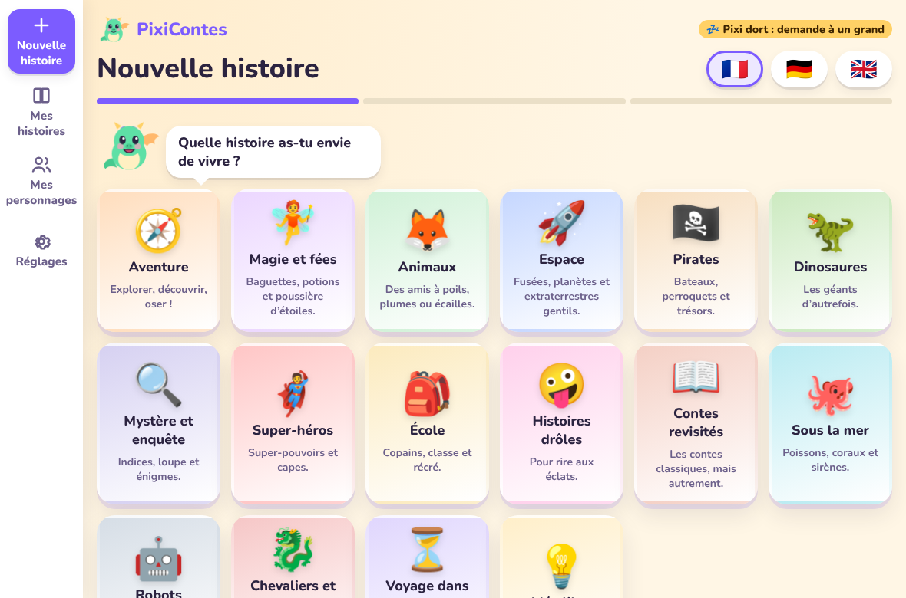
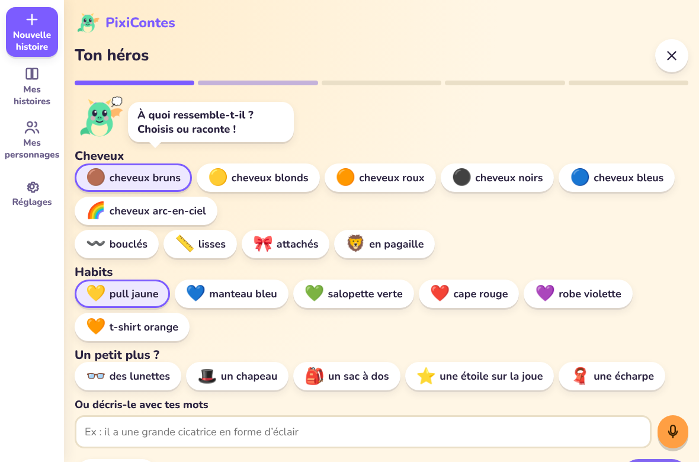
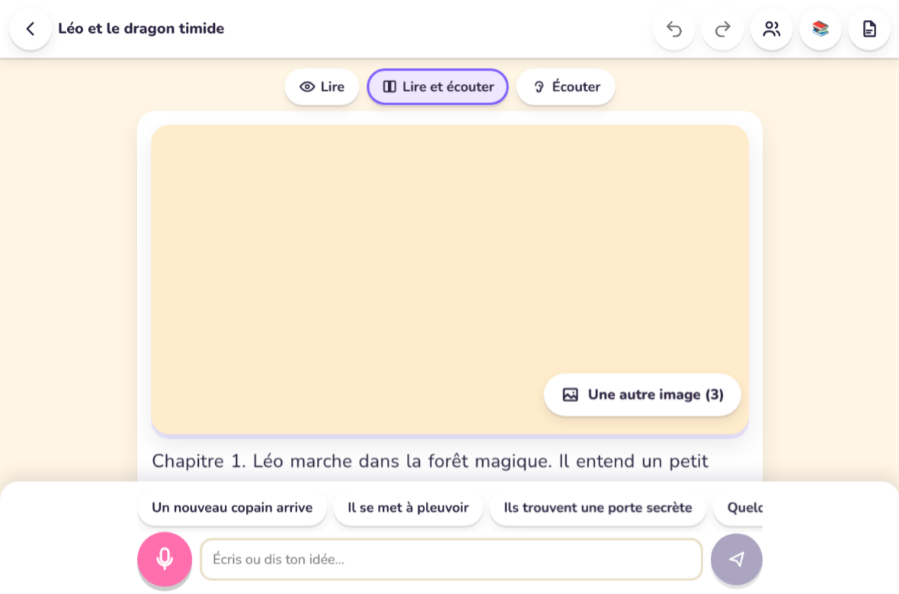
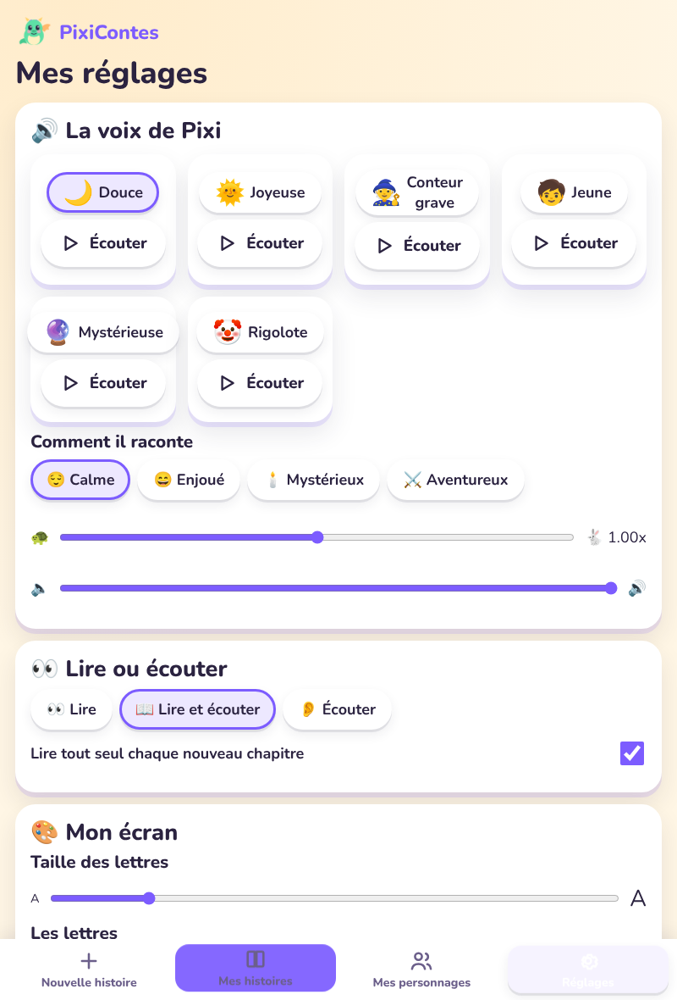
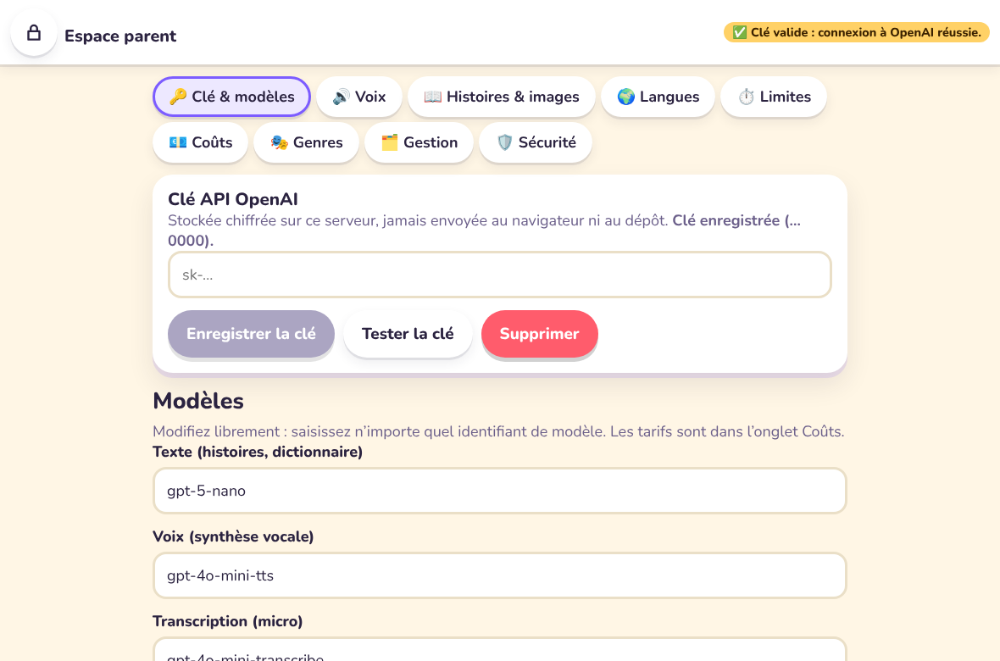
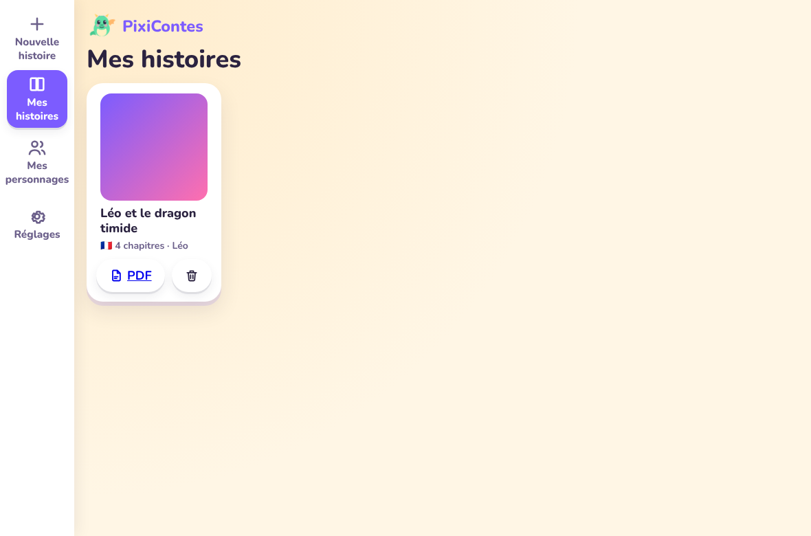

# Design system et écrans

**Principes** : chaleureux, ludique, très lisible. Une icône + un mot par action, zones tactiles ≥ 56 px, 4 espaces seulement (Nouvelle histoire, Mes histoires, Mes personnages, Réglages), aucune navigation profonde.

| Élément | Valeur |
|---|---|
| Couleurs jour | fond crème `#fff6e5`, encre `#2b2340`, violet `#7c5cff`, orange `#ff9f43`, menthe `#3fcf9f`, rose `#ff6fae`, ciel `#4fb4ff`, soleil `#ffd166` |
| Mode nuit | fond `#1b1838`, cartes `#2c2759`, encre `#f2edff` (apaisant, peu de blanc pur) |
| Typographie | Nunito (arrondie), option Atkinson Hyperlegible, option OpenDyslexic ; taille réglable 90 %–150 % |
| Formes | rayons 16–24 px, ombres douces « bouton posé », cartes de genre avec dégradé de leur couleur |
| Mascotte | Pixi, dragon SVG animé : repos (flotte, cligne), joie (saute), réflexion (balance), sommeil |
| Mouvement | livre qui s'ouvre (3D), propositions qui « popent », micro qui pulse, onde sonore, placeholder d'image qui scintille ; désactivé si `prefers-reduced-motion` |
| Sons | petites notes générées (WebAudio), désactivables |
| Accessibilité | contraste élevé en option, libellés ARIA, focus visible, paysage et portrait (barre latérale ↔ barre du bas) |

Les composants sont définis dans `frontend/src/styles.css`. Écrans clés (captures réelles de l'application, avec un faux serveur d'IA, donc image de chapitre vide) :

| | |
|---|---|
|  Choix du genre (paysage) |  Création du héros |
|  Lecteur et co-création |  Réglages enfant (portrait) |
|  Espace parent |  Mes histoires |

> Note de méthode : la consigne demandait une maquette avant l'implémentation. Ici, le design system (tokens + composants) a été écrit en premier, puis les écrans ont été construits directement dessus ; ces captures en tiennent lieu de maquette finale. Dites-moi si vous voulez des retouches visuelles.
